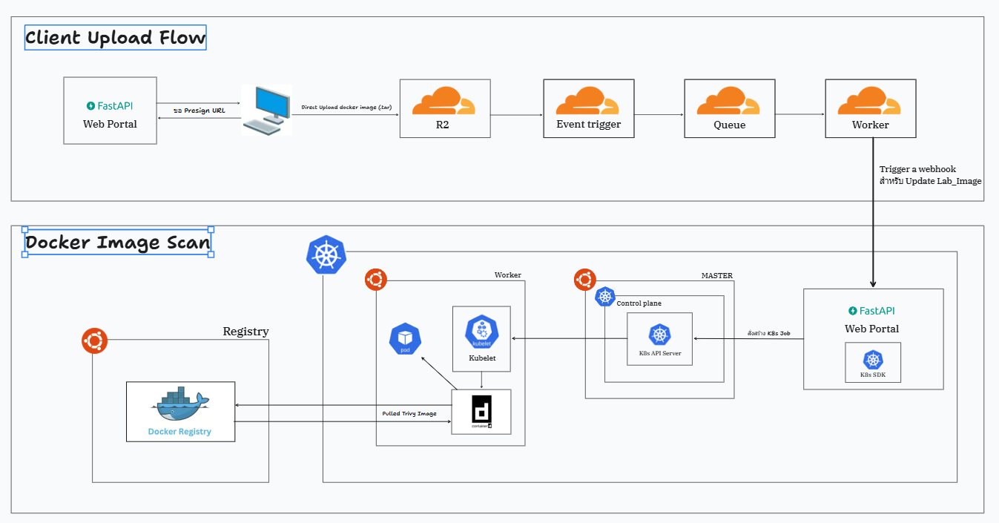

# Cloudflare R2 Event-Driven Pipeline

This project is a test of the Cloudflare R2 event trigger. We want to use it later in the container image (`.tar`) upload system of [VirtualLab Scanner Pipeline](https://github.com/NawapatThumthaisong97/VirtualLabtest).

## Purpose

In VirtualLab Scanner Pipeline, users upload a container image as a `.tar` file (for example from `docker save`). These files are often big. Before building the real system, we want to check that:

1. The client can upload the file directly to R2 with a presigned URL, so the file does not go through our backend
2. R2 sends an event when the upload is done (`PutObject` / `CompleteMultipartUpload`)
3. The event goes through Cloudflare Queue and a Worker to our backend, and it retries if sending fails
4. The backend saves the upload info to the database, so we can start the image scan from there

If this works, we will use the same idea for the "upload image, then start scan" step in VirtualLab Scanner Pipeline.

## Architecture



This picture shows the whole VirtualLab Scanner Pipeline. This project only tests the Client Upload Flow (top part): Client → R2 → Event trigger → Queue → Worker → Webhook.
Here we use Go (Fiber) + PostgreSQL instead of the Web Portal (FastAPI) to receive the webhook and save logs. The Docker Image Scan part (bottom) will be built in the real system.

Parts of this project

- **Terraform** ([infrastructure/terraform/cloudflare/](infrastructure/terraform/cloudflare/)) - creates the R2 bucket, CORS, Queue, event notification, Worker, and queue consumer
- **Worker** ([cloudflare-worker/index.js](cloudflare-worker/index.js)) - reads events from the Queue, changes the data format, and sends a webhook to the server. It calls `ack` if it works and `retry` if it fails
- **Server** ([server/](server/)) - Go + Fiber. Creates presigned URLs, receives the webhook (checks `Webhook-Secret`), and saves logs
- **Database** ([docker-compose.yml](docker-compose.yml)) - PostgreSQL 17 with `users` and `upload_logs` tables
- **Client** ([client/](client/)) - Next.js app for testing uploads

## API Endpoints

- `GET /health` - health check
- `GET /api/r2` - list upload logs (supports `limit` / `offset`)
- `POST /api/r2/presigned-upload` - get a presigned URL to upload a file to R2
- `POST /api/r2/presigned-download` - get a presigned URL to download a file
- `POST /api/webhook/upload-trigger` - receive events from the Worker (needs the `Webhook-Secret` header)

Example data sent by the Worker

```json
{
  "account_id": "xxxx",
  "object_key": "images/nginx-latest.tar",
  "action": "PutObject",
  "bucket": "my-bucket",
  "size": 187654321,
  "etag": "abc123...",
  "event_time": "2026-11-06T10:00:00Z"
}
```

The `upload_logs` table has a unique key on `(account_id, object_key, etag)`, so the same event is not saved twice if the Queue sends it again. It also has a `status` field (`pending` / `processed` / `failed`) for tracking the scan result later.

## How to Run

### 1. Database
```bash
docker compose up -d
```

### 2. Server
```bash
cd server
cp .env.example .env   # fill in R2 keys, DB settings, and WEBHOOK_SECRET
make run               # or make dev (auto-reload with air)
```

### 3. Cloudflare Infrastructure
```bash
cd infrastructure/terraform/cloudflare
cp terraform.tfvars.example terraform.tfvars   # fill in account id, api token, webhook_url, webhook_secret
terraform init
terraform apply
```

Notes
- `webhook_url` must be reachable from the internet, like a real domain or a tunnel (`cloudflared`, ngrok) pointing to `/api/webhook/upload-trigger`
- `webhook_secret` must be the same as `WEBHOOK_SECRET` in the server `.env`

### 4. Test
1. Call `POST /api/r2/presigned-upload` to get a URL
2. `PUT` a `.tar` file to that URL
3. Check `GET /api/r2` to see the new record in `upload_logs`

## Next Steps (for VirtualLab Scanner Pipeline)

- Only allow `.tar` files and set a max file size
- Support multipart upload for big images
- When an event comes in, send a job to the scanner and update `status` to `processed` / `failed`
- Link each upload to the user's `user_id`
